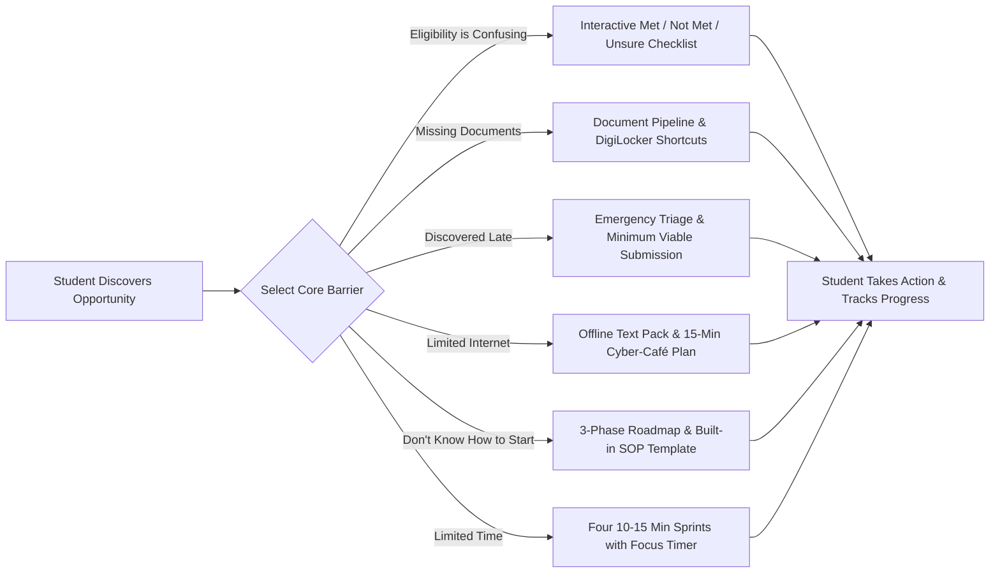

# EduBridge AI — Discover Opportunities. Remove Barriers. Take Action.

[](https://www.python.org/)
[](https://flask.palletsprojects.com/)
[](LICENSE)
[](#trust-and-safety)
[](#ai-opportunity-advisor)

**EduBridge AI** is an AI-powered opportunity discovery and action-acceleration platform for college students. It solves the real reason students miss scholarships, internships, competitions, and free courses: not a lack of talent or ambition, but systemic friction—dense legalese, missing paperwork, discovering deadlines too late, low bandwidth, or blank-page overwhelm.

---

## 🎯 The Main Innovation: The Barrier-to-Action Engine

Most edtech portals simply dump 100 links or offer a generic chatbot. **EduBridge AI** takes a radically different approach:

> **Don't just list opportunities or chat. Diagnose *why* the student hasn't applied, and generate an actionable, customized execution plan to remove that exact barrier.**



---

## 🚀 Key Features

### 1. Modern, Accessible Homepage
- Deep Navy (`#0B192C`, `#1E3E62`), Vibrant Teal (`#00A896`), and Warm Amber (`#D97706`) palette.
- Clear value proposition with immediate **"Find My Path"** and **"Guided Demo"** buttons.
- Fully accessible semantic HTML5 with keyboard navigation, visible focus rings, and WCAG AA contrast.

### 2. Privacy-First Student Profile
- Select **Study Level** (1st Year Undergrad, 2nd/3rd Year, Final Year, Postgrad, Diploma, Intermediate).
- Customize **Interests** (Technology & AI, Science, Social Impact, Business, Design).
- Select **Key Skills** and **Opportunity Types** (Scholarships, Internships, Competitions, Courses).
- **100% Privacy Guarantee:** All preferences are stored strictly in browser `localStorage`. No Aadhaar numbers, no bank accounts, no logins, and no uploads of sensitive documents.

### 3. Opportunity Explorer
Curated with 8 realistic, verified-source college opportunities:
1. **Reliance Foundation Undergraduate Scholarship 2026-27** — Up to ₹2,00,000 grant + mentorship
2. **Google Summer of Code (GSoC) 2026 Mentorship** — $1,500 – $3,000 USD stipend + global mentors
3. **Smart India Hackathon (SIH) 2026 Student Edition** — ₹1,00,000 cash prize per problem statement
4. **ISRO / IIRS Outreach Certification in Remote Sensing & GIS** — Free official ISRO certification
5. **National Means-cum-Merit Scholarship (NMMSS)** — ₹12,000/year Direct Bank Transfer
6. **Microsoft Learn Student Ambassadors (MLSA) Track** — $150/mo Azure credits + LinkedIn Learning
7. **UNDP & Youth Co:Lab Youth Innovation Challenge** — $5,000 equity-free seed grant
8. **Tata Trusts Medical & Engineering Higher Education Grant** — Up to 50% tuition fee waiver

Each opportunity provides verified official portal links, category badges, deadline countdowns, and eligibility highlights.

### 4. The 6 Specialized Barrier Solvers
| Barrier | Generated Action Plan & Tooling |
| :--- | :--- |
| **⚖️ Eligibility is confusing** | Line-by-line verification checklist with 3-way toggle (`[✓ Met]`, `[✗ Not Met]`, `[? Unsure]`). Dynamic eligibility score banner with guided resolution steps for unsure items. |
| **📂 I don't know which documents are needed** | Paperwork preparation roadmap with issuing authority, accepted file formats, and **DigiLocker shortcuts** to fetch instant marksheets and certificates. |
| **⏰ I discovered it late** | Emergency countdown alert, Minimum Viable Submission (MVP) checklist, 1-click **Add to Google Calendar** alert, and next-cycle notification registration. |
| **📶 I have limited internet or device access** | **1-Click Downloadable Offline Text Guide (`.txt`)** and the **15-Minute Cyber-Café / College Lab Battle Plan** (prepare offline on paper, upload in 15 mins for under ₹15). |
| **🧭 I don't know how to start** | Zero-pressure 3-phase micro-roadmap with a **Built-in Statement of Purpose (SOP) / Essay Starter Template** featuring 1-click copy. |
| **⏱️ I have limited time** | Four 10–15 minute micro-sprints split over 3 days, accompanied by an interactive **15-Minute Focus Sprint Timer (Pomodoro)** directly on the screen. |

### 5. AI Opportunity Advisor
- Translates bureaucratic rules into plain, actionable, student-friendly English.
- 1-Click preset questions:
  - *"Can 2nd year students apply?"*
  - *"What is the family income limit?"*
  - *"How do I get a college bonafide certificate?"*
  - *"What are the critical documents required?"*
- **Zero API Key Dependency:** Seamlessly powered by a verified rule-based knowledge engine out of the box; automatically elevates to Google Gemini (`gemini-3.8-flash`) if `GEMINI_API_KEY` is present.
- **Trust & Safety Guardrail:** Transparently states that it does not guarantee selection, directs students to official portals, and rejects sensitive queries (passwords, bank accounts, Aadhaar).

### 6. Progress Tracker & LocalStorage Persistence
- Tracks completed checklist items across all saved opportunities.
- Shows dynamic completion rate gauges (`0%` to `100%`).
- Retains progress across page refreshes and browser restarts.

---

## 🎬 The Demo Journey (Hackathon Presentation Flow)

To experience the full end-to-end journey specified in the problem statement:

1. Click **"🚀 Guided Demo"** in the top navigation bar or **"⚡ Try Interactive Demo"** in the hero section.
2. The demo automatically selects the **Reliance Foundation Undergraduate Scholarship** and launches the **"Eligibility is confusing"** barrier.
3. Observe how dense government/corporate criteria are broken into an interactive **3-way checklist**. Check off the first two conditions as `[✓ Met]` to see the dynamic eligibility banner instantly update.
4. Click **"🔄 Switch Barrier"** and select **"📶 I have limited internet or device access"**.
5. Notice how the engine immediately morphs into the **Low-Bandwidth Offline Battle Plan**:
   - Click **"💾 Download Offline Guide (.txt)"** to inspect the lightweight plain text guide.
   - Read the **15-Minute Cyber-Café Battle Plan** showing students how to draft on paper and upload quickly.
6. Click **"🤖 AI Advisor"** and test a question in **English** to see the instant verified AI advisor in action.

---

## 🛠️ Project Structure

```
EduBridge/
├── app.py                     # Flask server with REST API & Barrier Engine logic
├── requirements.txt           # Python dependencies
├── .env.example               # Optional Gemini API Key configuration
├── data/
│   ├── opportunities.json     # 8 realistic sample opportunities with structured criteria
│   └── barriers_rules.json    # Barrier engine configuration & metadata
├── static/
│   ├── css/
│   │   └── style.css          # Responsive, accessible WCAG AA design & print styles
│   └── js/
│       ├── app.js             # Application coordinator, routing, filters, demo tour
│       ├── engine.js          # Barrier-to-Action Engine (dynamic plan generation)
│       ├── storage.js         # LocalStorage persistence & progress tracker
│       └── assistant.js       # AI Opportunity Advisor (Gemini live / verified fallback, English)
├── templates/
│   └── index.html             # Single Page Application HTML5 structure
└── README.md                  # Project documentation & presentation guide
```

---

## 💻 Local Setup & Quickstart

### Prerequisites
- Python 3.10 or higher
- Modern web browser (Chrome, Edge, Firefox, Safari)

### Step 1: Clone or Navigate to the Directory
```bash
cd EduBridge
```

### Step 2: Install Python Dependencies
```bash
pip install -r requirements.txt
```

### Step 3 (Optional): Configure Gemini AI Key
If you have a Google Gemini API Key, copy the example environment file:
```bash
cp .env.example .env
```
Open `.env` and add your key:
```env
GEMINI_API_KEY=your_gemini_api_key_here
```
> **Note:** If no API key is provided, EduBridge AI automatically runs in its rich, instant, verified rule-based mode with full English answers.

### Step 4: Run the Application Locally
```bash
python app.py
```

### Step 5: Open in Your Browser
Visit:
```
http://127.0.0.1:5000
```

---

## 🌐 Live Cloud Deployment Guide (For Hackathon Judges & Evaluators)

EduBridge AI is production-ready for instant 1-click deployment on any modern cloud hosting platform (Render, Railway, Heroku, AWS, or Docker).

### Deployment Configuration Included:
* **Production WSGI Server:** `gunicorn` configured in `requirements.txt`.
* **Procfile:** Standard `web: gunicorn app:app --bind 0.0.0.0:$PORT` included.
* **Environment Variable Compatibility:** Binds dynamically to any host `$PORT` and reads `GEMINI_API_KEY` directly from the hosting platform's environment variables.
* **Zero Configuration Required:** If no `GEMINI_API_KEY` is set in the cloud dashboard, the platform boots instantly in its rich **Offline Verified Rule-Based Mode** with complete English guidance.

### Deploying to Render / Railway / Heroku:
1. **Connect Repository:** Link this GitHub repository in your hosting dashboard.
2. **Build Command:** `pip install -r requirements.txt`
3. **Start Command:** `gunicorn app:app` (or automatically picked up from `Procfile`)
4. **Environment Variables (Optional):**
   * If you wish to test live generative AI, set `GEMINI_API_KEY=your_key_here` in the cloud environment settings.
   * If left blank, the site runs 100% out of the box with zero errors.

---

## 🛡️ Trust & Safety Principles

1. **No Sensitive Data:** EduBridge AI never asks for or stores Aadhaar numbers, bank account numbers, IFSC codes, passwords, or scanned identity documents.
2. **Official Verification Links:** Every listing prominently links to the official government/corporate source portal (e.g. `scholarships.gov.in`, `sih.gov.in`).
3. **No False Promises:** The AI assistant and action plans explicitly remind students that EduBridge AI provides guidance and checklists, but cannot guarantee eligibility, selection, or scholarship funding.
4. **Offline Resilience:** Students with intermittent power or low connectivity can print or download complete checklists as `.txt` files.

---

## 👥 Hackathon Team & Acknowledgments
Built with ❤️ for college students across India navigating opportunities.
- **Theme:** Discover Opportunities. Remove Barriers. Take Action.
- **Innovation:** The Barrier-to-Action Engine.
